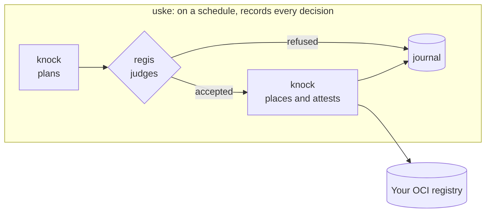
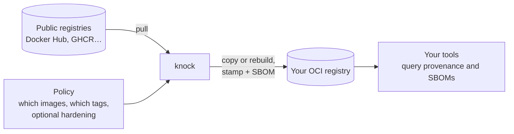

# knock

**Bring external images into your registry, each one stamped with provenance and an SBOM.**

<!-- trio:begin -->
> **regis** says whether. **knock** does. **uske** beats time, and records.

Together they form an admission gate for container images. [knock](https://github.com/trivoallan/knock)
plans every import, update or rebuild; [regis](https://github.com/trivoallan/regis) judges each image
against a declarative playbook; knock applies only what was accepted; [uske](https://github.com/trivoallan/uske)
runs this screening on a schedule and records every decision.


<!-- trio:end -->

## Why

2 a.m. A critical CVE drops, and there is one question: which of the images we run carry it, and
who owns them? Your images came in through a `docker pull` here and a mirror there, scanned by
different tools at different times, with no owner written on any of them. The answer becomes a
spreadsheet, built by hand, while the vulnerability is live.

## What it does



- **Places external images** in your registry: copied as-is, or rebuilt through a hardening policy
  you declare (internal CA certificates, internal package mirrors, timezone…).
- **Stamps every placed image** with portable provenance: OCI annotations plus signed SLSA / in-toto
  attestations.
- **Attaches a package-level SBOM** (SPDX and/or CycloneDX) to every image it places, copy or rebuild.
- **Stays in sync on its own**: re-running is a no-op unless the source digest moved or you changed
  the hardening.
- **Proves the front door holds**: `audit` lists the images that did not come through knock.

## Quick start

Mirror `busybox` into a throwaway local registry. You need `uv`, Docker and
[`regctl`](https://github.com/regclient/regclient/blob/main/docs/install.md).

```bash
git clone https://github.com/trivoallan/knock && cd knock
docker run -d -p 5001:5000 --name knock-demo registry:2
export KNOCK_REGISTRIES='{"local": {"host": "localhost:5001", "tls_verify": false}}'
uv run knock reconcile docs/examples/reference/busybox   # an example policy for busybox
```

Run it again: nothing moves, because the source did not. The
[ten-minute tutorial](docs/tutorials/getting-started.md) then shows the stamp and the SBOM.

## Is it for you?

**For you if** your organization runs public images and needs to know, for each one, where it came
from, what it contains and who owns it. knock needs neither regis nor uske.

**Not for you if** you only need a byte-for-byte copy. `skopeo sync` or your registry's replication
does that well. knock stamps and hardens, and that has a cost: a rebuilt image gets a new digest,
and every rebuild takes build time.

## Documentation

Everything lives in [`docs/`](docs/README.md):
[tutorials](docs/tutorials/README.md) ·
[how-to guides](docs/how-to/README.md) ·
[reference](docs/reference/README.md) ·
[explanation](docs/explanation/README.md) ·
[architecture and decisions](docs/architecture/README.md).

## Contributing

Issues and pull requests are welcome. Read [CONTRIBUTING.md](CONTRIBUTING.md) first.

## License

Apache License 2.0. See [LICENSE](LICENSE).
